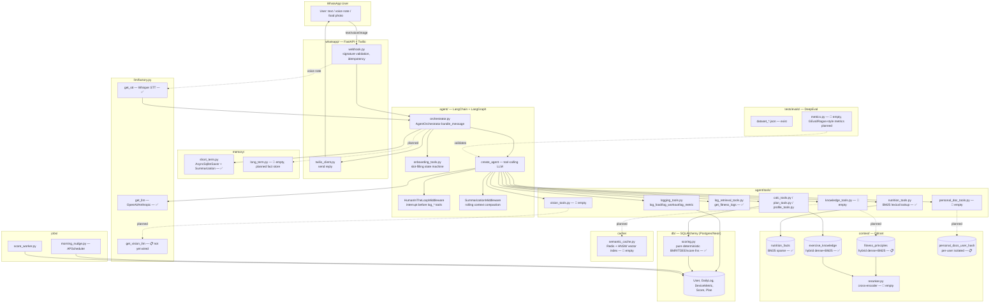

# Architecture & RAG Concept Map

Grounded in the actual repo state as of 2026-10-08 (not just the plan). ✅ = implemented/working code, 🚧 = scaffolded (file/dependency exists but empty or wired partially), 📋 = planned only, nothing built yet.

## 1. System architecture

## 2. RAG & agentic concept map

| # | Concept | Status | Where in repo | Tech used |
|---|---|---|---|---|
| 1 | **Chunking — lexical (BM25)** | ✅ Implemented | [nutrition_tools.py](ai_fitness_coach_rag/agent/tools/nutrition_tools.py) — indexes `nutrition_facts.json` as whole-entry "documents" (name + aliases), sparse vectors only | `langchain_qdrant.FastEmbedSparse("Qdrant/bm25")`, `RetrievalMode.SPARSE`, Qdrant |
| 2 | **Exercise retrieval — semantic/hybrid (dense+BM25)** | ✅ Implemented | [exercise_qdrant.py (indexer)](ai_fitness_coach_rag/context/indexers/exercise_qdrant.py), [exercise_qdrant.py (retriever)](ai_fitness_coach_rag/context/retrievers/exercise_qdrant.py), and [plan_tools.py](ai_fitness_coach_rag/agent/tools/plan_tools.py) — indexes the curated bundled exercise catalog into `exercise_knowledge` during application startup | `OpenAIEmbeddings(text-embedding-3-small)` + `FastEmbedSparse("Qdrant/bm25")`, `RetrievalMode.HYBRID`, Qdrant |
| 3 | **Eval metrics (GEval / contextual precision-recall)** | 📋 Planned | [tests/evals/metrics.py](tests/evals/metrics.py) empty; datasets already authored (`dataset_guardrails.json`, `dataset_logging_agent.json`, `dataset_rag_nutrition.json`, `dataset_onboarding.json`, `dataset_personal_doc_rag.json`, `dataset_summary_scoring.json`) | `deepeval` (`>=4.0.7`, dev dependency in [pyproject.toml](pyproject.toml)) |
| 4 | **Ragas** | 📋 Planned, not in dependencies | Not referenced anywhere in code or `pyproject.toml` yet — current eval direction is DeepEval `GEval`, not Ragas | Would need `ragas` added as a dependency if adopted |
| 5 | **RRF (Reciprocal Rank Fusion) / Ranking** | ✅ Built into exercise retrieval | Qdrant hybrid retrieval over `exercise_knowledge`; [reranker.py](ai_fitness_coach_rag/context/retrievers/reranker.py) remains unused | Qdrant hybrid query fusion |
| 6 | **Reranking (cross-encoder)** | 📋 Planned | [reranker.py](ai_fitness_coach_rag/context/retrievers/reranker.py) — file exists, empty | Target: `sentence-transformers` MiniLM cross-encoder (local, no extra API cost) |
| 7 | **Memory — STM (short-term)** | ✅ Implemented | [memory/short_term.py](ai_fitness_coach_rag/memory/short_term.py) — per-user (`thread_id=phone`) rolling conversation state + summarization | `langgraph-checkpoint-sqlite` (`AsyncSqliteSaver`), `langchain.agents.middleware.SummarizationMiddleware` |
| 8 | **Memory — LTM (long-term)** | 🚧 Scaffolded only | [memory/long_term.py](ai_fitness_coach_rag/memory/long_term.py) — empty; intended as a lightweight soft-preference fact store (SQL, not vectorized) | Target: SQLAlchemy table, no embeddings |
| 9 | **HNSW (vector index)** | ✅ Used by exercise retrieval | Qdrant creates the dense-vector index for the `exercise_knowledge` hybrid collection; nutrition remains sparse-only | Qdrant |
| 10 | **MCP (Model Context Protocol)** | 📋 Dependency present, unused | `langchain-mcp-adapters` listed in [pyproject.toml](pyproject.toml) but no MCP client/server wiring found anywhere in `agent/` | Target: `langchain-mcp-adapters` |
| 11 | **Tools (agentic tool-calling)** | ✅ Implemented | [orchestrator.py](ai_fitness_coach_rag/agent/orchestrator.py) — `create_agent(tools=[lookup_nutrition, log_food, log_workout, log_metric, get_fitness_logs])` | `langchain.agents.create_agent`, `@tool` decorator (LangChain) |
| 12 | **Skills** | 📋 Not present as a distinct concept | No skill-packaging abstraction in this repo (tools are flat `@tool` functions) | — |
| 13 | **HITL (Human-in-the-loop)** | ✅ Implemented | [orchestrator.py](ai_fitness_coach_rag/agent/orchestrator.py) — `HumanInTheLoopMiddleware` interrupts before `log_food`/`log_workout`/`log_metric`; resumed via `Command(resume=...)` on user YES/NO, with retry-then-auto-cancel exit strategy | `langchain.agents.middleware.HumanInTheLoopMiddleware`, `langgraph.types.Command`, backed by the same `AsyncSqliteSaver` checkpointer as STM |
| 14 | **Guardrails / intent routing** | 📋 Planned, not built | Plan mentions an `agent/router.py` intent/guardrail classifier; file doesn't exist. `dataset_guardrails.json` + `test_guardrails.py` exist as eval scaffolding only | Target: cheap LLM classifier gating off-topic/unsafe input before tool/RAG calls |
| 15 | **Speech-to-text (STT)** | ✅ Implemented | [llm/factory.py](ai_fitness_coach_rag/llm/factory.py) — `get_stt()` returns an OpenAI client; `get_stt_translate_model()` resolves the Whisper model | OpenAI Whisper (`whisper-1`, via `openai` SDK) |
| 16 | **Caching in LLM — semantic cache** | 🚧 Scaffolded only | [cache/semantic_cache.py](ai_fitness_coach_rag/cache/semantic_cache.py) — empty; planned to gate only `knowledge_tools` RAG lookups (never logging/scoring/personalized replies), key = query + domain tag, TTL-based | Target: Redis + `redisvl` (HNSW vector index) |
| 17 | **Caching in LLM — prompt caching / other** | 📋 Not implemented | No explicit prompt-cache config seen in `llm/factory.py` (plain `ChatOpenAI`/`ChatAnthropic` construction, `temperature=0`, no cache flags) | Target: provider-native prompt caching (OpenAI/Anthropic) if adopted |

## 3. Implemented vs. planned — quick summary

**Working today:**
- Tool-calling agent (LangChain `create_agent`) with deterministic tools for logging and nutrition lookup.
- BM25 sparse lexical RAG for nutrition facts (Qdrant).
- Human-in-the-loop confirmation before any DB write (LangGraph interrupt/resume).
- STM via LangGraph `AsyncSqliteSaver` + `SummarizationMiddleware`.
- Deterministic scoring engine (BMR/TDEE, daily score) — pure Python, unit tested.
- Speech-to-text via OpenAI Whisper.
- Twilio WhatsApp gateway (FastAPI webhook + signature validation).

**Scaffolded (files/deps exist, no logic yet):**
- Hybrid dense+BM25 knowledge base (`fitness_principles`, `exercise_technique`) + cross-encoder reranker.
- Personal document RAG (per-user isolated Qdrant namespace).
- Vision-based calorie estimation from food photos.
- Long-term memory fact store.
- Redis semantic cache for knowledge lookups.
- DeepEval metrics + eval test wiring (datasets are authored, runner logic is not).
- `langchain-mcp-adapters` dependency (no MCP usage yet).

**Planned, no scaffolding yet:**
- Intent/guardrail router (`agent/router.py`).
- Ragas-based evaluation.
- Explicit RRF/ranking fusion tuning beyond Qdrant's built-in hybrid mode.
- Provider-native prompt caching.
