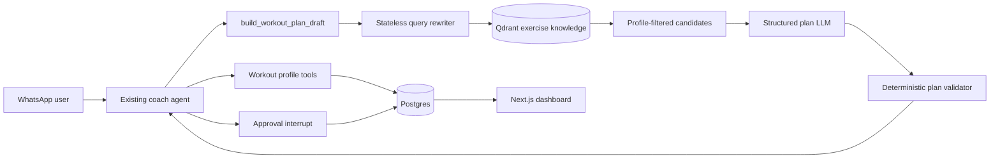

# Workout Plan Feature

## Goal

Allow an already-onboarded user to ask for a personalized workout plan in
WhatsApp. The agent gathers only missing workout preferences, proposes a
validated plan, applies requested edits, and saves the exact approved JSON for
the dashboard to render.

The planner uses measurable inputs, not body-type labels:

- Goal: fat loss, muscle gain, or general fitness.
- Training experience: beginner, intermediate, or advanced.
- Available equipment.
- Available days and session duration.
- Exercise preferences and dislikes.
- Injuries or limitations supplied by the user.

V1 supports three to four sessions weekly, each 30 to 60 minutes. It must not
provide medical guidance or prescribe around injuries.

## Architecture



The existing single tool-calling agent remains the orchestration point. A
multi-agent router is unnecessary for this feature. The main LLM conducts the
conversation and explains the proposal. Plan generation uses a separate,
stateless structured-output query-rewriter call before retrieving candidates;
it is not a tool-calling agent and has no checkpointer, conversation memory, or
database access. Tools own profile state, retrieval, validation, and
persistence.

## Postgres Data Model

Add the following models in `ai_fitness_coach_rag/db/models.py`.

### WorkoutProfile

One row per user, linked by a unique `user_id` foreign key.

- `training_experience`: beginner, intermediate, or advanced.
- `equipment`: JSON array of canonical equipment keys.
- `workout_days_per_week`: integer from 1 to 7.
- `session_duration_minutes`: positive integer.
- `preferences`: JSON array of exercise or activity preferences.
- `injuries_or_limitations`: nullable text supplied by the user.
- `updated_at`: UTC timestamp.

### Workout Plans

Extend the existing `Plan` model, or add a dedicated `WorkoutPlan` model, with
the following workout-specific fields:

- `status`: draft, active, or archived.
- `title` and `goal_type`.
- `plan_json`: exact approved plan stored as Postgres `JSONB`.
- `profile_snapshot_json`: profile values used when the plan was generated.
- `approved_at`: nullable UTC timestamp.

The dashboard reads `plan_json` directly; it never regenerates plans.

## Exercise Catalog

Use the Kaggle CSV files already in the repository as the catalog source:

- `ai_fitness_coach_rag/db/seed_data/gym_exercise_dataset.csv`
- `ai_fitness_coach_rag/db/seed_data/stretch_exercise_dataset.csv`

The CSV files are the canonical exercise source for V1. Do not duplicate their
contents in Postgres. Build a catalog loader that normalizes both datasets into
one in-memory `ExerciseCatalogEntry` representation:

```json
{
  "slug": "goblet-squat",
  "name": "Goblet Squat",
  "equipment": ["dumbbell"],
  "difficulty": "beginner",
  "movement_pattern": "squat",
  "primary_muscles": ["quadriceps", "glutes"],
  "preparation": "Hold one dumbbell at chest height.",
  "execution": "Lower with control, then stand.",
  "search_text": "Goblet squat dumbbell quadriceps glutes beginner..."
}
```

Map the raw columns as follows:

| Normalized field | Gym CSV source | Stretch CSV source |
| --- | --- | --- |
| `name` | `Exercise Name` | `Exercise Name` |
| `equipment` | `Equipment` | `Equipment` |
| `preparation` / `execution` | `Preparation` / `Execution` | `Preparation` / `Execution` |
| `primary_muscles` | `Target_Muscles`, `Main_muscle` | `Target_Muscles`, `Main_muscle` |
| `difficulty` | `Difficulty (1-5)` | absent; assign during curation |
| `search_text` | combined normalized fields | combined normalized fields |

The loader must normalize whitespace and equipment labels, generate stable
slugs, and deduplicate same-name variations. It must also apply a curated V1
allowlist. The raw datasets include highly specialized and potentially unsafe
movements, so they must not all become plan candidates automatically.

The datasets do not provide images. V1 can omit exercise images from the plan
and dashboard. Add external `image_url` values later through a small, separate
metadata override file; do not store image binaries in Qdrant or Postgres.

## Qdrant Exercise Knowledge

Create an `exercise_knowledge` collection in the existing Qdrant deployment.
Index the normalized, allowlisted CSV records using their `search_text`,
preparation, execution, and muscle details. Store payload fields for
`exercise_slug`, equipment, difficulty, source dataset, and muscle tags.

Qdrant supports semantic requests such as "a leg exercise that is easier on my
knees." It is not the authoritative source for programming variables or safety
filters. Retrieval must apply payload filters derived directly from the saved
profile, then hydrate final candidates from the normalized CSV catalog by
`exercise_slug`.

### Profile-Aware Query Rewriting

When a user requests a complete workout plan, the planner sends the current
request and saved `WorkoutProfile` to a small, stateless structured-output LLM
call. This query rewriter returns a `WorkoutRetrievalSpec` containing:

- One semantic query for warm-up mobility.
- One semantic query for cool-down mobility.
- One query per required main movement pattern: squat, hinge, lunge, push,
  pull, core, carry, or full-body.
- Soft preference and safety terms that improve semantic relevance.

The rewriter can interpret requests such as "quiet home workout," "low
impact," or "fat loss," but it must not decide whether equipment, difficulty,
movement patterns, or injury-related constraints are allowed. Those hard
constraints come directly from the saved profile and are applied as Qdrant
payload filters. The rewriter has no tools, checkpointer, conversation memory,
or persistence.

If rewriting fails or Qdrant is unavailable, the planner builds basic queries
from the profile and falls back to direct filtering of the curated CSV catalog.
Semantic retrieval improves candidate relevance; it is never the only path to
a valid plan.

## Workout-Profile Conversation

Basic profile onboarding continues to use the existing onboarding flow. The
workout-profile flow starts only when an onboarded user requests a plan.

1. The agent calls `get_workout_profile_gaps`.
2. It asks one concise question for the next missing field.
3. It calls `save_workout_profile_answer` with the explicit answer.
4. The tool validates and persists canonical values.
5. The process repeats until the workout profile is sufficient.
6. The agent creates a plan draft.

The LLM must not silently infer equipment, experience, available time, or
injury constraints. Ambiguous input requires a follow-up question.

## Agent Tools

Implement these tools in `ai_fitness_coach_rag/agent/tools/plan_tools.py`:

- `get_workout_profile_gaps()`: returns missing fields and the next question.
- `save_workout_profile_answer(field, value)`: validates and persists an
  explicit user answer.
- `search_exercise_options(query, filters)`: retrieves semantically useful
  exercise candidates with payload filters and catalog hydration.
- `build_workout_plan_draft(user_request)`: rewrites the request using the
  saved profile, retrieves candidates per movement category, and produces the
  structured draft.
- `validate_workout_plan(plan_json)`: rejects unavailable equipment,
  contraindicated movements, unsupported exercises, duplicate patterns, and
  invalid volume.
- `save_workout_plan(plan_json)`: persists the exact approved JSON and archives
  any prior active plan.

Use deterministic programming templates for V1, while allowing profile-aware
semantic retrieval to select relevant candidates for each template:

- Beginner full-body, three days weekly.
- Fat-loss strength and conditioning, three days weekly.
- Hypertrophy upper/lower, four days weekly.

The query-rewriter LLM interprets soft preferences, and the plan-generation
LLM composes the personalized draft. Equipment, difficulty, movement-pattern,
injury, and catalog-existence constraints remain enforced by metadata filters
and deterministic validation.

## Agent Prompt And Approval

Add a compact workout-planning section to `fitness_coach_system` in
`ai_fitness_coach_rag/agent/prompts.json`:

```text
When the user requests a workout plan, first check for missing workout-profile
preferences and ask only for the next missing preference. Use only exercises
returned by the exercise catalog tools. Present a structured draft, apply
requested edits, and save it only after explicit approval. Do not give medical
guidance or work around injuries; recommend a qualified professional when
appropriate.
```

Register the workout tools with the existing agent in
`ai_fitness_coach_rag/agent/orchestrator.py`. Add `save_workout_plan` to the
current `HumanInTheLoopMiddleware` configuration, so saving a plan uses the
same persisted YES/NO approval flow as logging. User edits such as "make it 30
minutes" or "replace lunges" should update the draft and present it again for
approval.

## Approved Plan JSON

Store the following complete document after user approval:

```json
{
  "title": "3-Day Dumbbell Fat-Loss Plan",
  "goal": "lose",
  "days": [
    {
      "day": "Day 1",
      "focus": "Full body",
      "exercises": [
        {
          "exercise_id": "goblet-squat",
          "name": "Goblet Squat",
          "sets": 3,
          "reps": "8-12",
          "rest_seconds": 90,
          "notes": "Keep your torso tall."
        }
      ]
    }
  ],
  "progression_rule": "Add one rep per set until 12, then increase load.",
  "safety_note": "Stop if pain occurs."
}
```

## Dashboard

Add a read-only Plans page in `dashboard/`.

- Query the active workout plan for the authenticated user directly from
  Postgres.
- Render each day, focus, exercises, sets, reps, rest, and notes. Render an
  image only when a later catalog metadata override provides an `image_url`.
- Show plan status, approval date, and a history of archived plans.
- Render only approved persisted JSON; the dashboard does not call the planner
  or modify plans.

## Implementation Order

1. Add models and database migration for workout profiles and plan JSON/status.
2. Build a normalized, allowlisted catalog loader over the downloaded gym and
  stretch CSV files.
3. Build the Qdrant indexer and exercise retrieval with payload filters.
4. Add the stateless structured query rewriter and its deterministic fallback.
5. Implement per-pattern candidate retrieval, deterministic templates, catalog
  filtering, and plan validation.
6. Add workout-profile and plan tools, including the current user request in
  plan-draft generation.
7. Register tools, prompt rules, and approval handling in the existing agent.
8. Build the read-only dashboard Plans page.
9. Add unit, integration, agent-conversation, retrieval-fallback, and dashboard
  query tests.

## Test Coverage

- CSV normalization and allowlist selection are deterministic.
- Catalog filters exclude unavailable equipment and contraindicated exercises.
- Plan templates produce valid output for every V1 goal and experience level.
- Query rewriting converts profile and request context into structured,
  movement-specific retrieval queries.
- Qdrant returns relevant candidates while profile-derived metadata filters
  remain enforced.
- Qdrant failure or insufficient results trigger the curated CSV fallback.
- A conversation fills gaps, saves answers, creates a draft, applies edits, and
  saves only after approval.
- Users can retrieve only their own plans.
- The dashboard renders an active plan and archive history from persisted JSON.